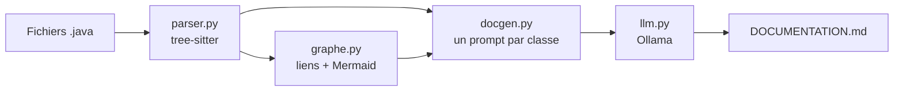
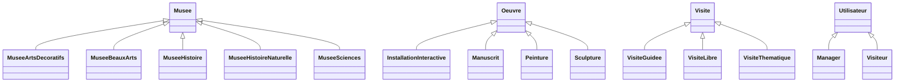

# RetroDoc

[](https://github.com/MasteerH/retrodoc/actions/workflows/ci.yml)

J'ai écrit RetroDoc pour documenter automatiquement un projet **Java** qui n'a pas de documentation. Je lui donne un dossier de code, il me rend un fichier Markdown avec le diagramme des classes et un résumé de chaque classe.

## Comment ça marche



1. **Je lis le code.** J'utilise [tree-sitter](https://tree-sitter.github.io/) pour extraire les classes, les interfaces et les enums, avec leurs attributs, leurs méthodes et leur parent.
2. **Je construis le graphe.** Je relie les classes par trois types de liens (hérite, implémente, utilise) et je l'exporte en diagramme Mermaid.
3. **Je fais rédiger les résumés.** Pour chaque classe, j'envoie à un LLM son code et la signature de ses voisines, avec la consigne de ne décrire que ce qui est dans le code.

Je n'entraîne aucun modèle. J'utilise un LLM existant qui tourne en local avec [Ollama](https://ollama.com/).

## Installation

Il faut Python 3.11 ou plus.

```bash
git clone https://github.com/MasteerH/retrodoc.git
cd retrodoc
python -m venv .venv
.venv\Scripts\Activate.ps1        # Linux/macOS : source .venv/bin/activate
pip install -e ".[dev]"
```

Pour les résumés, il faut aussi Ollama et un modèle :

```bash
ollama pull qwen2.5-coder:7b
```

## Utilisation

**En ligne de commande**

```bash
retrodoc analyze chemin/vers/projet     # structure en JSON, sans LLM
retrodoc doc chemin/vers/projet         # documentation complète en Markdown
```

**Par l'API**

```bash
uvicorn retrodoc.api:app
```

| Route | Rôle |
|---|---|
| `POST /analyses` | reçoit un zip du projet, renvoie un identifiant |
| `GET /analyses/{id}` | renvoie la structure en JSON |
| `GET /analyses/{id}/doc` | renvoie la documentation en Markdown |

La page `http://127.0.0.1:8000/docs` permet d'essayer les routes.

**Avec Docker**

```bash
docker build -t retrodoc .
docker run -p 8000:8000 retrodoc
```

Le conteneur cherche Ollama sur la machine hôte. L'adresse se change avec la variable `OLLAMA_URL`. Sous Linux, il faut ajouter `--add-host=host.docker.internal:host-gateway`.

## Résultat sur un vrai projet

J'ai testé RetroDoc sur mon projet de hackathon Java (gestion de musées, 22 fichiers).

| Mesure | Valeur |
|---|---|
| Types trouvés | 23 (22 classes, 1 enum) |
| Méthodes trouvées | 131 |
| Liens dans le graphe | 48 (14 d'héritage, 34 d'utilisation) |
| Temps de génération | environ 90 s |
| Résumés corrects | 7 sur 10 |

La documentation complète est ici : [docs/exemple-hackathon.md](docs/exemple-hackathon.md).

**Le diagramme d'héritage obtenu :**



**Un résumé généré (classe `Salle`) :**

> La classe Salle représente une salle d'exposition dans un musée. Elle contient des informations comme son identifiant, son nom, sa capacité, son thème, le nombre de visiteurs actuels et les salles et œuvres associées. Elle offre des méthodes pour gérer les visiteurs (ajouter ou retirer), vérifier si la salle est pleine, et afficher son effectif.

## Pourquoi 7 sur 10

J'ai relu 10 résumés en les comparant au code, phrase par phrase. J'ai retiré un point à chaque résumé qui contenait une de ces trois fautes :

| Ma règle | Classe | Ce que le LLM a écrit |
|---|---|---|
| **−1 pour une traduction.** Je demande une réponse en français sur un code en français, le LLM ne doit pas renommer les classes. | `Manager` | « l'objet Museum », alors que la classe s'appelle `Musee` |
| **−1 pour une invention.** Le résumé ne doit rien contenir qui ne soit pas dans le code. | `VisiteGuidee` | « un musée ou un site culturel », alors que le code ne parle jamais de site culturel |
| **−1 pour une affirmation fausse.** | `Main` | la classe « démontre le comportement du manager », alors que cet appel est en commentaire |

Les 7 autres résumés sont justes. Dans deux d'entre eux, le LLM écrit « surcharge » au lieu de « redéfinit » : j'ai toléré ce mot, car le sens reste correct.

Sur les 10 résumés, le LLM n'a inventé aucune méthode et aucun attribut. Ses erreurs portent sur des détails, pas sur la structure du code.

## Tests

```bash
ruff check retrodoc tests
pytest --cov=retrodoc
```

- 45 tests, 96 % de couverture.
- Les tests n'appellent jamais le vrai LLM : je le remplace par un faux client qui renvoie un texte fixe.
- À chaque push, GitHub Actions lance `lint` (ruff), `test` (pytest) et `build` (image Docker).

## Structure

```
retrodoc/
  parser.py      lit le Java avec tree-sitter
  models.py      ClassInfo, MethodInfo, FieldInfo, ParametreInfo
  graphe.py      liens entre classes + export Mermaid
  llm.py         LLMClient + OllamaClient
  docgen.py      prompts + assemblage du Markdown
  api.py         API FastAPI
  cli.py         commandes analyze et doc
tests/           tests + petits fichiers .java
docs/            documentation générée sur le hackathon
```

## Limites

- **Je ne résous pas les appels de méthodes.** Je sais qu'une classe utilise une autre classe, pas quelle méthode elle appelle.
- **Le LLM se trompe parfois** : 3 résumés sur 10 ici. La documentation doit être relue.
- **Java seulement.** Un autre langage demande un autre parseur.
- **Je ne lis pas toute la syntaxe.** Les classes internes et les records sont ignorés, et `int a, b;` ne garde que `a`.
- **L'API est une démonstration.** Les analyses restent en mémoire, sans limite de taille ni authentification.
